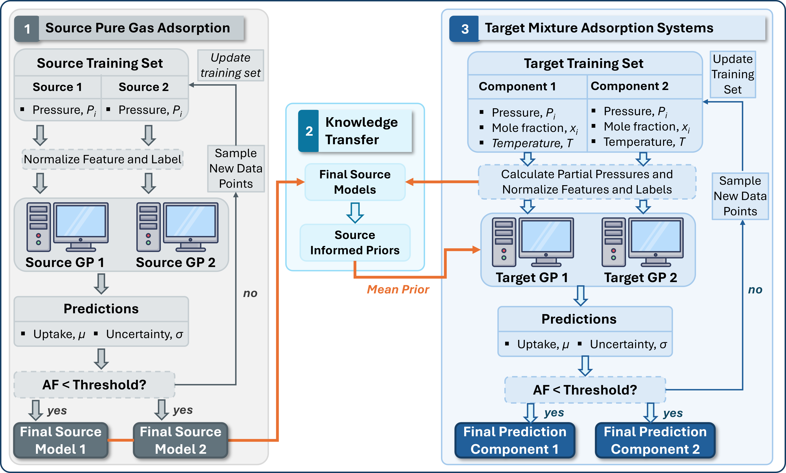

# GP-Transfer-Active-Learning-for-Gas-Mixture-Adsorption-Prediction-in-MOFs 

### Description ###

This repository contains the full implementation, datasets, and environment requirements for the transfer active learning (TAL) framework for data-efficient gas mixture adsorption prediction in metal-organic frameworks (MOFs). TAL combines active learning (AL) and transfer learning (TL) to leverage pure component adsorption data for multi-component gas adsorption prediction across a range of thermodynamic conditions, reducing the data required for mixture adsorption prediction in MOFs. 

The framework is built on a Gaussian process regression (GPR) model with stacked single-target (SST) formulations for transfer from the pure-component source to the multi-component target, with uncertainty-based sampling to minimize data collection on both tasks. It was demonstrated for three mixtures (CO<sub>2</sub>/CH<sub>4</sub>, CO<sub>2</sub>/H<sub>2</sub>S, and Xe/Kr) in four MOFs (Cu-BTC, IRMOF-1, IRMOF-10, and NU-800) at pressures and temperatures up to 300 bar and 400 K, and includes tests varying the initial training data size, training data selection scheme, and AL stopping criteria, an ablation study of the transfer, and a comparison with IAST.

All models are evaluated on a held-out test set: 20% of every GCMC grid is held out before any training, for five random splits (seeds 0–4).

The code, adsorption datasets, GCMC simulation files, and dependency specifications needed to reproduce the results are provided here.

### Installation

```bash
conda env create -f environment.yml
conda activate GPR_env
```

### Repository Structure

[`job_script`](job_script): Main code for the AL / TAL implementation used by every run script (`heldout.py`, `GPR.py`, `systems.py`), the scripts that summarize the results, and `run_all.sh`.

[`Datasets`](Datasets): Adsorption data for the P-X and/or P-X-T space across the MOFs and mixtures, with the held-out splits (`splits/`) and the boundary-informed (BI) training sets (`BI/`).

[`CO2-CH4`](CO2-CH4): CO<sub>2</sub>/CH<sub>4</sub> mixture in Cu-BTC (`cubtc`), IRMOF-1 (`irmof1`), IRMOF-10 (`irmof10`) and NU-800 (`nu800`):
- `Data_Size_Test`: initial training data size test (TAL, LHS selection, GP RE stopping criterion), in Cu-BTC and IRMOF-1; P-X sizes 5–40 (5, 10, 15, 20, 25, 30, 35, 40), P-X-T sizes 5, 10, 20, 25, 40.
- `Data_Distribution`: training data selection scheme, LHS (`M`) vs BI (`M1`), TAL with the GP RE stopping criterion.
- `AF_Test`: PAC stopping criterion: TAL and direct AL with LHS.
- `Ablation_Test`: transfer GP (TGP, pure-component prior) vs direct GP (zero prior mean) on the same training points, without AL.

[`CO2-H2S`](CO2-H2S) and [`Xe-Kr`](Xe-Kr): CO<sub>2</sub>/H<sub>2</sub>S and Xe/Kr mixtures in Cu-BTC:
- `Data_Size_Test`: initial training data size test, as above.
- `AL_TAL`: TAL and direct AL with LHS selection and the PAC stopping criterion.
- `Ablation_Test`: as above.

[`IAST_Calculation`](IAST_Calculation): IAST predictions with the pyIAST module for every mixture and MOF (`IAST_calc_px.py`, `IAST_calc_pxt.py`), their outputs (`iast_pred_*.csv`, `iast_metrics_*.csv`), and IAST scored on the held-out test points (`IAST_test_metrics_*.csv`; up to 10 bar: `iast_10bar_test_*.csv`).

[`Plot`](Plot): Figure generation notebooks for all systems (AL comparison, data size, isotherms and residuals, ablation), with the AL and TAL results they plot, and the split seed shown in the plots (`Median_seed.csv`).

[`GCMC_simulation`](GCMC_simulation): RASPA input files, force field, molecule and CIF files, and the raw RASPA output of the GCMC simulations run in this work.

Every analysis folder holds the run scripts, `names.csv` (the runs) and the results: `All_metrics.csv` (every run and split seed) and `Summary_metrics.csv` (mean and standard deviation over the five splits); ablation folders also hold `Ablation_summary.csv`.

### Run names

| Name | Meaning |
|---|---|
| `TAL_Pure_<g>_<g>` | TAL: pure-component model of gas `<g>` as the prior of the mixture model of `<g>` |
| `AL_<g>` | direct AL on the mixture (no transfer) |
| `ABL_<g>` | ablation test (GP and TGP arms) |
| `_M` / `_M1` | initial training data from LHS / from the BI set |
| `_pxt` | P-X-T space (AL runs; TAL runs cover all spaces of a gas in one run) |

Gases: `CO` = CO<sub>2</sub>, `CH` = CH<sub>4</sub>, `HS` = H<sub>2</sub>S, `Kr`, `Xe`.

### Reproducing the results

All commands are run from the repository folder.

1. **Held-out splits.** They are provided in `Datasets/.../splits/`. `python job_script/make_splits.py --force` would recreate them.
2. **Runs.** `bash job_script/run_all.sh <analysis folder>` runs every script in its `names.csv` for split seeds 0–4. Each run writes its results to `<analysis folder>/<run>/`: `Metrics_*` (test metrics), `History_*` (GP error and PAC per AL iteration), `Sampled_*` (training points) and `Pred_*` (predictions over the full grid). A single run and seed: `cd <analysis folder>/<run> && python ../<run>.py <seed>`.
3. **Summaries.** `python job_script/collect_metrics.py <analysis folder>` writes `All_metrics.csv` and `Summary_metrics.csv`; for ablation folders, also `python job_script/ablation_summary.py <analysis folder>` (`Ablation_summary.csv`).
4. **Split seed shown in the plots.** `python job_script/median_seed.py` writes `Plot/Median_seed.csv`. It needs the runs of `CO2-CH4/<mof>/AF_Test` and of `CO2-H2S/AL_TAL` and `Xe-Kr/AL_TAL`.
5. **IAST.** `cd IAST_Calculation/<MOF>[/<mixture>] && python IAST_calc_px.py` (and `IAST_calc_pxt.py`). The scripts read their inputs, the pure-component and mixture data, from `Datasets`.
6. **IAST on the held-out test points.** First run the TAL scripts of `CO2-CH4/<mof>/AF_Test` (`TAL_Pure_*_M`) and of `CO2-H2S/AL_TAL` and `Xe-Kr/AL_TAL` (step 2), since the test points are taken from their `Pred_*` files. Then `cd IAST_Calculation && python ../job_script/iast_test_metrics.py` and `python ../job_script/iast_10bar_test.py`.
7. **Figures.** Open the notebooks in `Plot/` (`jupyter notebook`). They read the GCMC data from `Datasets`, the IAST predictions from `IAST_Calculation`, the data size results from `<system>/Data_Size_Test/Summary_metrics.csv`, and the AL and TAL results at the split seed in `Plot/Median_seed.csv` from their own folder. The ablation figures: `python Plot/Ablation/plot_ablation.py`, which reads `<system>/Ablation_Test/All_metrics.csv`.

### Method details

- **Held-out test set.** Each GCMC grid is split once per seed into a 20% test set, stratified by mole fraction (P-X) or temperature (P-X-T), and an 80% pool. The initial training points, all AL queries, the input-scaling statistics and the stopping criteria use the pool only, and all metrics (R<sup>2</sup>, MAE, MAPE) are computed on the test set only. The result files give MAPE as a fraction (0.05 = 5%). The `GP MRE` column of the `History_*` files is different: the GP's mean relative uncertainty (σ/|μ|) on the remaining pool at each AL iteration. In IRMOF-1, IRMOF-10 and NU-800 the 1 Pa points always stay in the pool, as the next pressure is 0.2 bar and testing at 1 Pa would be extrapolation (split rule `lowest_p` in `job_script/systems.py`).
- **Transfer prior.** The pure-component GP enters the mixture GP at the partial pressure x·P, scaled with the pure-isotherm statistics (`'prior': 'xP'` in the run scripts). Below the lowest pure-component pressure (1 Pa) the prior follows Henry's law; above the highest (10 bar) it is held at its 10 bar value.
- **IRMOF-1, IRMOF-10 and NU-800.** Grid points where the modelled gas is absent (x = 0) are left out, consistent with the mole-fraction range of 0.02–0.98. The MAPE is computed over test points with a GCMC uptake above zero. Each metrics row records this in `x0_rows` (`dropped` / `kept`); results written before this column was added have no `x0_rows` and kept every row.
- **BI points.** BI training points that are also on the GCMC grid are removed from the pool and the test set; the LHS (`M`) runs are scored on the same test set as the BI (`M1`) runs.
- **Initial mixture training data size** (from the data size test): Cu-BTC CO<sub>2</sub>/CH<sub>4</sub> P-X 20 and P-X-T 25; IRMOF-1, IRMOF-10 and NU-800 P-X 5; CO<sub>2</sub>/H<sub>2</sub>S P-X 10 and P-X-T 5; Xe/Kr P-X 15 and P-X-T 20. The pure-component model starts from 15 LHS points of each pure isotherm.
- **Stopping criteria.** GP RE: the maximum relative GP uncertainty on the remaining pool is below 2%. PAC: at least 90% of the remaining pool points have a relative GP uncertainty below 2%. In TAL the pure-component model stops on GP RE.

### Datasets

- `Pure_<gas>_data.csv`: pure-component isotherms at 298 K (1 Pa–10 bar).
- `Mixture_px.*`: mixture grid in the P-X space; `Mixture_pxt.csv`: mixture grid in the P-X-T space (200–400 K).
- Every file gives the loading and its statistical error (block averaging, `Error` columns) at each state point. The isotherm plots show the 95% confidence interval, loading ± 2 × error.
- All scripts, including the IAST scripts, read the data files by the names given here.
- The CO<sub>2</sub>/CH<sub>4</sub>, CO<sub>2</sub>/H<sub>2</sub>S and Xe/Kr mixture data in Cu-BTC are those of Mukherjee et al.: K. Mukherjee, E. Osaro and Y. J. Colón, *Active learning for efficient navigation of multi-component gas adsorption landscapes in a MOF*, Digital Discovery, 2023, **2**, 1506–1521, https://doi.org/10.1039/D3DD00106G. The pure-component isotherms in Cu-BTC use the same adsorbate models.

### GCMC simulations

`GCMC_simulation` holds, for each system simulated in this work (RASPA 2.0.50):

- `simulation.input`: the RASPA input file. The pressure (`XXX` in pure-component inputs, `MMM` in mixture inputs) takes each value in `Pressures.csv`; in mixture inputs the CH<sub>4</sub> mole fraction (`EEE`) takes each value in `molefractions.csv`, and the CO<sub>2</sub> mole fraction (`FFF`) is 1 − `EEE`. `HeliumVoidFraction` (pure CO<sub>2</sub> and CH<sub>4</sub> inputs) only enters RASPA's excess loading, not the absolute loading used here.
- `raw_output.tar.xz`: the RASPA output file (`.data`) of every state point. `tar -xJf raw_output.tar.xz` extracts them to `raw_output/<pressure>/[<CH4 mole fraction>/]Output/System_0/`. The loadings and errors in `Datasets` are the "Average loading absolute [milligram/gram framework]" values of these files. In these copies the machine name (`Hostname:`) and the local RASPA folder (`RASPA directory set to:`) are replaced with `[removed]`; nothing else is changed.

`shared/` holds the files the inputs use, in the RASPA folder layout (copy them into `$RASPA_DIR/share/raspa/`): the force field (`forcefield/UFF`: UFF for the frameworks, mixing rules and pseudo atoms), the adsorbate models (`molecules/TraPPE`: TraPPE for CO<sub>2</sub> and CH<sub>4</sub>, the Kristóf–Liszi model for H<sub>2</sub>S, single Lennard-Jones sites for Xe and Kr), and the CIF files of the four MOFs with the m-CBAC charges used in all simulations (`structures/cif`).

The Cu-BTC mixture data come from Mukherjee et al. (see Datasets), so they have no simulation files here.

### Versions

- `v1.0`: code and data of the original submission.
- `v2.0`: revised version: held-out evaluation, corrected transfer prior, re-simulated pure H<sub>2</sub>S, Kr and Xe isotherms in Cu-BTC, ablation study, IAST calculations and GCMC simulation files.

### TAL Framework


